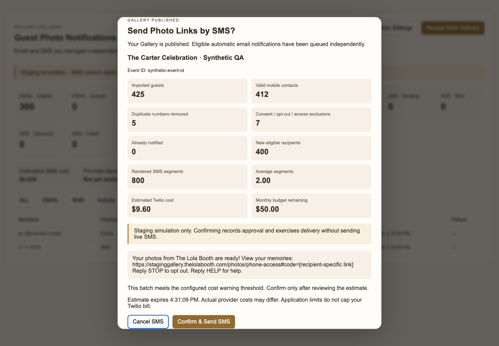
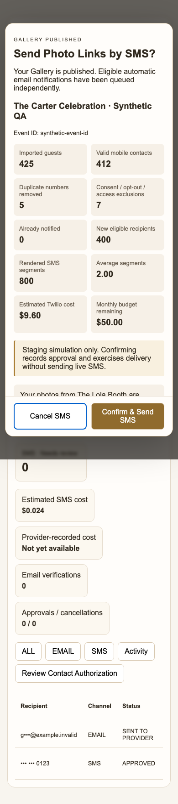
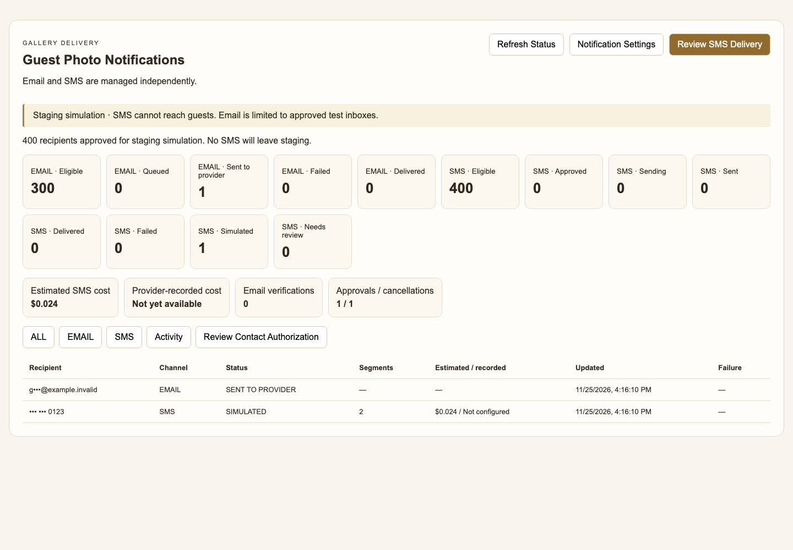
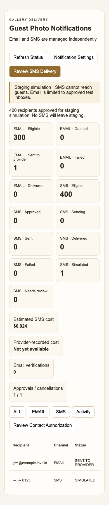

# Gallery transactional photo delivery — staging, 25 November 2026

## Scope and release boundary

Implements the attached Twilio/Gallery prompt in the existing Admin/API/worker and public Gallery applications. The owner explicitly selected **token-scoped email verification, with future phone lookup deferred until trustworthy phone ownership exists**. No production promotion is authorized. No production Gallery was published, no customer message was sent, and no Twilio account was provisioned.

Staging URLs:
- Admin / Gallery delivery report: https://stagingadmin.thelolabooth.com/operations/galleries
- Find My Photos: https://staginggallery.thelolabooth.com/find-photos
- SMS landing: https://staginggallery.thelolabooth.com/photos/phone-access (requires the private fragment token)
- Email verification: https://staginggallery.thelolabooth.com/photos/verify-email (requires the private fragment token)
- Existing shopping: https://stagingshop.thelolabooth.com/shop

## Implemented flow

1. Import, upload, match and prepare Gallery records without notification side effects.
2. Record the existing guest's transactional photo-delivery authorization in **Notifications → Review Contact Authorization** before publication. This records the Admin, time, channel and evidence; imported phone/email details alone are insufficient. Marketing authorization remains separate.
3. Existing Gallery publication transaction creates a stable publication record and one idempotent email delivery per event/contact. It reuses encrypted Fiesta contacts, existing person/album grants, branded email rendering and communications. The email is queued as a controlled Gallery job; generic communication sends cannot bypass it. Queued Gallery emails and verification messages cannot be edited to retarget their recipients or access links.
4. Successful publication opens **Send Photo Links by SMS?**. Cancel receives keyboard focus. The dialog shows event identifiers, imported/valid/duplicate/excluded/already-notified/new recipient counts, fully rendered segment counts, estimate, available monthly budget, warning and blocking reasons. Confirm is never automatic.
5. Confirm locks settings/budget state, rechecks current eligibility, requires an unexpired review and unchanged pricing version, reserves budget, stores immutable reviewed recipients/messages/rates and records the approving Admin. Cancel records a decision and sends nothing; publication/email remain intact. Later reviews are fresh and incremental.
6. Dedicated worker claims each delivery once and rechecks Gallery grants, authorization and global/CRM opt-outs. Interrupted/unknown submissions are never automatically retried. No failed email triggers SMS.
7. Staging SMS always becomes **SIMULATED** before any Twilio client can be constructed. Simulated messages have no provider charge and release their simulated budget reservation. General SMS remains disabled. This cannot be overridden with live credentials or live flags in staging.
8. First SMS-link access validates the active grant and expiring capability, then requests email verification before any photo is shown. Verified email opens only that token's authorized collection. Existing download restrictions and event boundaries remain enforced on every read.

## Identity and security

- SMS tokens are random 256-bit, fragment-only links, hashed at rest outside the encrypted approval snapshot, expire after one hour and are consumed atomically after email verification.
- Email verification tokens expire after 15 minutes, are single-use, rate limited, and allow at most five requests per SMS access grant. No extra SMS verification is sent.
- The email-verification session expires with its SMS access grant. Revoked access, expired Gallery retention, inactive people or revoked original Gallery keys prevent continued photo retrieval.
- A forwarded token never establishes permanent phone ownership or overwrites an existing phone/email association. A valid forwarded capability can complete its single-use, limited email-verified access; this is the token-scoped model explicitly chosen by the owner.
- `gallery_trusted_phone_emails` has no public write/enrollment path. A verified email reached through an SMS capability never populates it. Existing `keepsakes_unverified_contacts` are never promoted or consulted as ownership evidence.
- Phone Find My Photos ignores a caller-supplied destination email. Only an independently trusted ownership record can route to its associated verified email. Without one, responses remain neutral and direct guests to their original link, email lookup or support. No SMS is sent by lookup.
- API permissions retain existing event-scoped Gallery access. Settings, consent changes and SMS decisions require integration-writing authority. Reports filter through the same event-access policy.
- Secrets/tokens stay out of route URLs, reports, analytics and audit payloads. Private pages use no-store/no-referrer. Capability values remain in fragments or request bodies, not third-party links.

## Consent, opt-outs and compliance

Eligibility requires matching visible photos, active Gallery grants, valid US number format or email, recorded transactional authorization, and no suppression. Duplicate numbers are grouped per event, including multiple pictures/identity rows. Existing lead/client `sms_opted_out_at` and `OPTED_OUT` status suppress delivery. Twilio STOP creates a global hashed-number suppression; HELP/START do not generate Lola SMS or silently restore authorization. Advanced Opt-Out remains responsible for provider compliance acknowledgments.

Number format validation is not a promise of mobile-carrier deliverability. Confirm sending-program requirements and supported destinations before live use. No native Fiesta sharing is replaced.

## Cost and approval model

- GSM-7 extension characters count as two units. Single/multipart segment sizes are 160/153; UCS-2 uses UTF-16 units and 70/67, including emoji pairs.
- Each recipient's exact private link is rendered before approval. Base, carrier and other known per-segment USD fees are explicit integer microdollars. A dated pricing source is required; no default commercial rate is invented.
- Defaults: SMS disabled, monthly budget $50, per-Gallery cap $10, warning $5, maximum 500 recipients, maximum three segments. All editable in Admin.
- Approval reservations serialize across Galleries. A review expires in 15 minutes and settings changes require a new review. Month rollover invalidates queued reservations before dispatch. Reservations and actual recorded prices reconcile without double-counting.
- Signed delivery callbacks are retained in a durable inbox, including callbacks that arrive before the submission response, and update states monotonically. Provider failures appear in recipient records and never trigger automatic resend. Admin cost reconciliation fetches the provider message with the official SDK, validates account/service/currency and applies only the price delta.
- Estimates and provider-recorded prices may exclude later adjustments or charges not present on the message resource. The app limit is **not a guaranteed Twilio bill cap**.

## Notification state transitions

| Record | Transitions |
| --- | --- |
| Review | Pending → Approved or Canceled; expired/settings-changed requires fresh review |
| Email | Queued → Submitting → Sent to provider, Failed, Suppressed or Unknown |
| SMS | Approved → Submitting → Simulated in staging; future approved live release may progress Queued → Sending → Sent → Delivered / Undelivered / Failed |
| Interrupted send | Submitting older than 10 minutes → Unknown; no automatic resubmission |
| Access | Active token → email requested → email verified + token consumed → scoped session; revocation/expiry invalidates reads |

## Screens and reports

- Gallery detail **Notifications** tab: separate email/SMS counts, cost, approval/cancellation activity, recipient statuses, failures, contact authorization and notification settings.
- Accessible SMS confirmation dialog with explicit Cancel/Confirm, mobile layout, focus containment and no preconfirmed action.
- Gallery list **Gallery Delivery Report**: published Galleries, email notifications, SMS approvals/cancellations, recipients/segments/cost, failures, email verifications, returning email access and voluntary Keepsakes navigation. Metrics drill into matching Gallery records.
- Returning phone ownership associations are explicitly deferred. Voluntary shopping navigation is counted as an operational event, not a marketing conversion.
- First SMS-link email collection and single-use email-verification screens preserve the shared public Gallery header/footer.

Screenshots below are **local synthetic browser fixtures**, not a real guest batch or a live Twilio submission:






## Twilio setup and remaining live qualification

The official `twilio` Node SDK is installed. Messaging Services submission, exact canonical URL signature validation, inbound compliance callbacks and read-only provider cost reconciliation are implemented. SDK automatic retries are disabled. Staging simulation does not require credentials.

A names-only check found **none of these variables on either staging API or staging worker**:

```
TWILIO_ACCOUNT_SID
TWILIO_API_KEY_SID
TWILIO_API_KEY_SECRET
TWILIO_MESSAGING_SERVICE_SID
TWILIO_AUTH_TOKEN
```

Configure credentials privately in Railway; never paste them into chat or the repository. Both API and worker need the account/service configuration; API validates signatures and performs Admin reconciliation, worker owns dispatch. Do not change `SMS_PROVIDER=none`.

Staging callback endpoints:
- `https://stagingapi.thelolabooth.com/api/gallery-twilio/status`
- `https://stagingapi.thelolabooth.com/api/gallery-twilio/inbound`

Before a separately approved live release: confirm the actual Twilio account, approved sender pool, US A2P/toll-free registration as applicable, transactional consent wording, Advanced Opt-Out behavior, Smart Encoding/link settings, current base/carrier/additional fees, signed callbacks, controlled provider delivery and recorded charges. Sender verification flags/reference are deployment gates, not proof that Twilio has approved a program. Verify that evidence independently before setting them.

The future live adapter additionally requires `APP_ENV=production`, `GALLERY_SMS_LIVE_ENABLED=true`, `TWILIO_SENDER_REGISTRATION_REVIEWED=true` and `TWILIO_SENDER_REGISTRATION_EVIDENCE`. **None were enabled by this work.** A new explicit production release approval is required before deployment or configuration.

Official references:
- [Twilio message lengths and segmentation](https://www.twilio.com/docs/glossary/what-sms-character-limit)
- [Twilio webhook signature validation](https://www.twilio.com/docs/usage/security)
- [Messaging Services](https://www.twilio.com/docs/messaging/services)
- [Advanced Opt-Out](https://www.twilio.com/docs/messaging/tutorials/advanced-opt-out)
- [Test credentials](https://www.twilio.com/docs/iam/test-credentials): SMS test credentials do not support `MessagingServiceSid`; local simulation does not claim to validate a real Messaging Service.

## Migration and files

Migration `096_gallery_notifications.sql` adds settings, transactional authorization, hashed suppressions, stable publication records, immutable reviews, monthly budget reservations, per-event deduplicated deliveries, short-lived SMS access, email verification, trusted-ownership evidence storage and aggregate activity. It does not import legacy unverified identities or publish/send existing Galleries.

Main files:
- `shared/gallery-notification-policy.js` — segment counting, validation, rates and callback transitions.
- `server/src/services/gallery-notification-service.js` — publication, eligibility, approval, budget, worker, verification and reporting.
- `server/src/services/gallery-twilio-adapter.js`, `server/src/routes/gallery-twilio.js` — official SDK and signed webhooks.
- Existing `private-gallery-service.js`, `keepsakes-photo-access-service.js`, `automation-service.js`, `worker.js`, Gallery/Keepsakes routes and API entry point — integration and dispatch restrictions.
- `src/components/GalleryGuestNotifications.jsx`, `GalleryNotificationReport.jsx`, `GalleryPhoneAccess.jsx`, `src/styles/gallery-notifications.css` — interface.
- Existing `GalleryAdmin.jsx`, `GalleryHome.jsx`, `KeepsakesPhotoJourney.jsx`, `App.jsx`, shared lookup message — existing navigation and retrieval updates.
- `test/gallery-notification-policy.test.js`, `gallery-notifications-db.test.js`, `gallery-notifications-browser.test.js`, updated `keepsakes-photo-access-db.test.js` — regressions.
- `package.json` / lockfile — official Twilio SDK.

## Validation

- Full unit suite: **843 passed, 66 skipped, 0 failed** (909 tests; opt-in database/browser suites run separately).
- Synthetic 400-recipient lifecycle, pricing and repeated-click/cancel tests passed. Expanded database lifecycle: **20 tests passed**; sequential Gallery notification, Fiesta, Dropbox, deletion and lookup regressions: **24 passed**, with the additional immutable-recipient case subsequently passing in the expanded lifecycle pack.
- Cross-Gallery concurrent approvals cannot reserve over the same monthly budget.
- Signed Twilio STOP/HELP and forged-signature tests passed; no duplicate compliance response or unrelated SMS sends.
- Token/email verification, forwarded-token limits, revoked grants, unknown-phone neutrality, trusted-only lookup and arbitrary-email takeover prevention passed.
- Staging live flags cannot construct a Twilio client. Unapproved email destinations remain blocked even with the legacy broad QA switch enabled. All provider-facing unit tests use stubs/development transport; zero real messages or charges.
- Responsive browser interaction passed at 1440 and 390 pixels, including Cancel focus, initially visible event heading and decision controls, zero premature sends, later fresh review and confirmation.
- Production build passed. Hosted deployment/CI evidence is appended after rollout.

**Readiness:** ready for staging review/simulation; live SMS and production promotion remain blocked on the setup and independent qualification above. Permanent phone enrollment is deliberately deferred by the owner's instruction.
