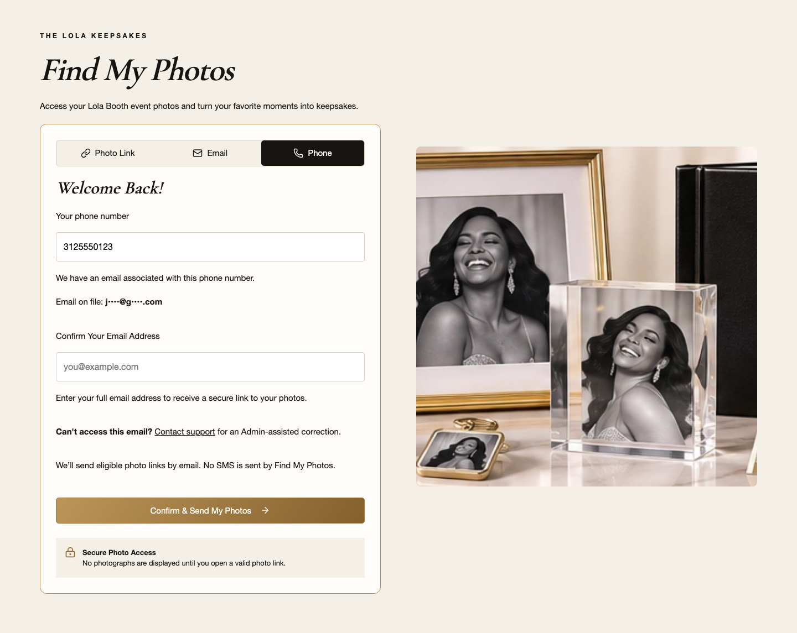
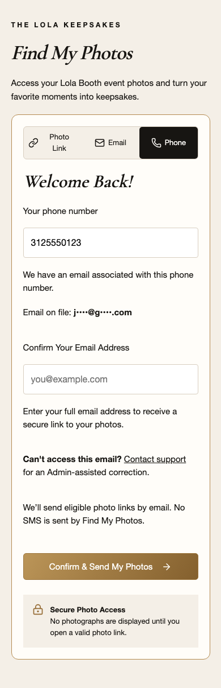
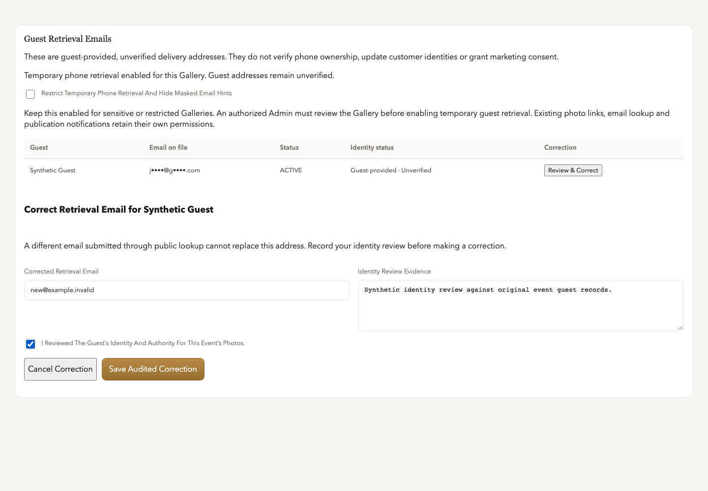
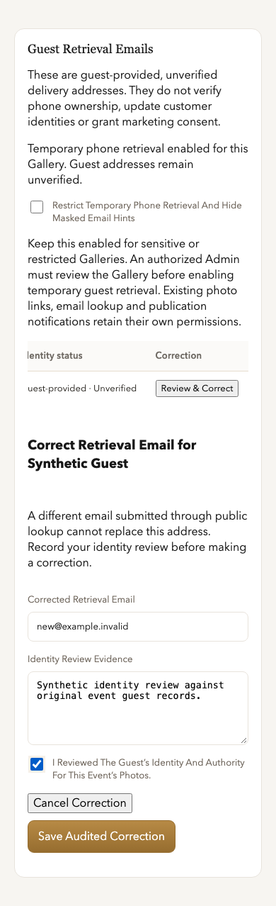

# Returning guest masked retrieval email — staging, 26 November 2026

Implements the owner's latest addendum for **Find My Photos**. This updates the previous trusted-only public phone lookup policy for guest-provided retrieval addresses. It does not establish verified phone ownership or change the existing Admin-approved SMS flow.

## How to enable and use

In **Admin → Galleries → select Gallery → Settings → Guest Retrieval Emails**, an authorized Admin can disable **Restrict temporary phone retrieval and hide masked email hints** for an ordinary Gallery after reviewing its sensitivity. Existing and new Galleries default to restricted; the migration does not silently expose phone/email hints from previously private records. Keep restricted Galleries restricted.

On [staging Find My Photos](https://staginggallery.thelolabooth.com/find-photos), choose **Phone**:

1. Enter the phone number and select **Continue**.
2. For an eligible first-time guest, enter a retrieval email. The record is saved as **UNVERIFIED / GUEST_PROVIDED**, tied to the existing person, event/Gallery and access grant. No OTP or SMS is sent.
3. For an eligible returning guest, the form shows **Welcome Back!**, a mask such as `j••••@g••••.com`, **Confirm Your Email Address**, and **Confirm & Send My Photos**. The complete normalized email must match the saved address on the server.
4. Correct eligible details queue a freshly generated, expiring, recipient-specific collection link to the **saved** email. Incorrect details queue nothing. Both return the same neutral response; neither reveals a photo link or full saved address in the browser response.
5. **Can't access this email?** links to existing support. Public lookup cannot replace a saved address. An Admin may correct it after recording identity-review evidence and explicitly confirming the review.

Original photo links, email lookup, downloads, sharing and shopping retain their existing authorization checks. Email lookup can also deliver the eligible event-scoped collection to its saved guest-provided address; this does not promote that address to verified customer identity.

## Multiple associations and restricted access

Public phone retrieval requires an unambiguous, eligible person/event association. Multiple event/person associations, conflicting historic emails, unpublished/expired/revoked access, restricted Galleries or invalid records do not expose a hint or automatically pick a recipient. The guest receives the same generic email-entry/recovery experience as an unknown number. Use email lookup, the original event-specific photo link or Admin-assisted recovery.

The original Gallery key, person, publication status, retention, assigned photos and temporary-association version are rechecked before dispatch, redemption and photo access. A newer revoked personal key cannot be bypassed through an older album-scoped retrieval association.

Admin correction is event-scoped and audited with the staff identity, association, old/new versions and review evidence. It invalidates prior retrieval capabilities/sessions tied to the old version. Correcting an email does not reactivate revoked or expired Gallery access.

## Data and delivery

Migration **097_guest_retrieval_email.sql** adds:

- A Gallery-level temporary-retrieval restriction, defaulting to restricted.
- Event/person/key-scoped guest retrieval addresses with encrypted contact data, keyed contact hashes, versioning, an immutable UNVERIFIED classification, and ACTIVE / REVIEW_REQUIRED status.
- Anonymous, expiring retrieval sessions and challenges. These provide rate-control/session binding, not photo access.
- Persistent phone/IP/session attempt limits and a controlled email-delivery state on the existing photo request outbox.

Historic `keepsakes_unverified_contacts` are migrated per original scope. Conflicting historic addresses for the same scope require Admin review. No verified customer identity, trusted phone/email binding or marketing-consent record is created or overwritten.

Phone retrieval email uses existing branded email rendering, the **View My Photos** CTA, communications, expiring photo requests and Gallery access sessions. Controlled drafts cannot be edited to retarget recipients or sent through generic Communications actions. The dedicated worker rechecks eligibility, processes once, suppresses stale/revoked requests and never automatically retries an unknown submission outcome.

Staging enforces the approved email test-inbox allowlist even if the older broad QA bypass flag is enabled. This work sends no live SMS and adds no Twilio Verify / OTP integration. Publication email eligibility and manually approved Gallery SMS remain unchanged.

## Abuse prevention

- Complete email comparison is normalized server-side using the existing trim/lowercase policy and keyed, timing-safe comparison.
- Phone and email values remain encrypted at rest; IP/rate identifiers are keyed hashes.
- Five failed confirmations per phone or session, or twenty per IP, block further attempts for fifteen minutes. Rotating sessions/IPs does not bypass the phone limit; rotating numbers/sessions does not bypass the IP limit.
- Search quotas apply per phone, IP and session, with an additional HTTP rate limit.
- Expired challenges, different sessions, stale association versions and consumed confirmations cannot authorize a delivery. Concurrent first registrations cannot overwrite one another.
- Replaying a successful confirmation cannot resend; a two-minute contact cooldown limits fresh requests.
- Unknown, wrong, restricted and ambiguous cases use neutral responses where possible. Ordinary masked hints are shown only after an Admin enables the Gallery's temporary flow.
- Expired anonymous sessions/challenges and old rate buckets are cleaned by the worker. Association lifetime remains bound to the existing Gallery records and permissions.

## Endpoints and files

Public:
- `POST /api/keepsakes/photos/phone/retrieval/start`
- `POST /api/keepsakes/photos/phone/retrieval/confirm`

Admin (existing authentication, event access and operation/integration permissions required):
- `GET /api/gallery-admin/albums/:id/guest-retrieval`
- `PUT /api/gallery-admin/albums/:id/guest-retrieval/restriction`
- `PUT /api/gallery-admin/albums/:id/guest-retrieval/:addressId`

Main changes: migration 097; `guest-photo-retrieval-service.js`; `guest-retrieval-policy.js`; `GalleryGuestRetrieval.jsx`; existing `KeepsakesPhotoJourney.jsx`, Gallery Admin, photo access service, Gallery/Keepsakes routes, communications protections and worker; persistent database and desktop/mobile browser tests; CI inclusion of the new browser checks.

## Validation

- New migration/security/database pack: **17 passed**, including first-time save, returning mask, normalized match, wrong-email suppression, phone/IP/session blocking, concurrent registration, versioned Admin correction, legacy conflicts, ambiguous events, restricted/unpublished/revoked access and personal-grant revocation.
- Existing Gallery notification, lookup, Fiesta, Dropbox and deletion database regressions passed alongside the new flow.
- Full unit suite: **844 passed, 68 skipped, 0 failed** before the final focused checks; required CI validates the final head.
- Public first-time/returning forms checked at 1440, 390 and 320 pixels. Full email is required; no Yes/Confirm bypass, full saved address or photo URL is displayed.
- Admin restriction/correction form checked at 1440 and 390 pixels. Saving requires the explicit identity-review checkbox and review evidence.
- Existing own-photo product previews, included-photo downloads/sharing and Gallery controls browser checks passed.
- Gallery-enabled Vite build passed. All local data are synthetic; email uses the development transport, with external calls blocked in database tests. No production changes or live SMS.

Screenshots are **synthetic local browser fixtures**, not real guest details:

Staging deployment and CI evidence are recorded in the final validation report. Production promotion requires separate explicit approval.
